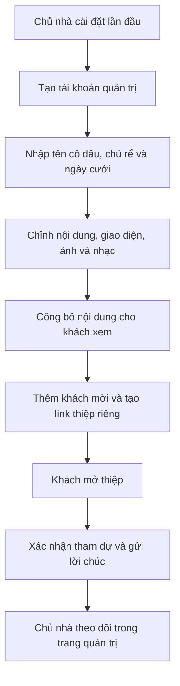
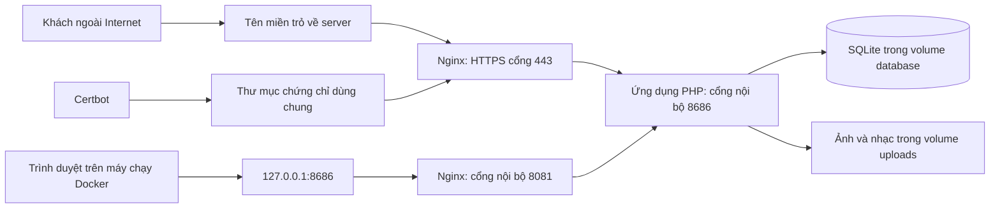

# Hướng dẫn chạy Docker và tìm hiểu dự án thiệp cưới

Tài liệu này giải thích cách chạy source bằng Docker, từ cài đặt trên máy
cá nhân đến triển khai bằng tên miền. Nội dung dựa trên cấu hình trong
[docker-compose.yml](docker-compose.yml) của bộ source này.

**Chưa có tên miền vẫn có thể cài đặt và tìm hiểu ứng dụng qua
<http://localhost:8686/setup> trên chính máy chạy Docker.**

## 1. Concept của dự án

Đây là ứng dụng thiệp cưới online viết bằng PHP, dùng CodeIgniter 3 và
SQLite. Giao diện được render từ PHP; dữ liệu và ảnh nằm ở nơi chạy
ứng dụng.

Với cấu trúc hiện tại, mỗi bộ cài và bộ dữ liệu riêng phục vụ một website
cưới cho một cặp đôi. Mỗi khách mời có thể nhận một đường dẫn thiệp riêng
trên cùng website đó.

Luồng sử dụng chính:



Ứng dụng phân biệt bản nháp và bản đã công bố:

- Khi đăng nhập quản trị, bạn có thể xem và sửa bản nháp.
- Khách xem nội dung đã công bố.
- Sau khi sửa và công bố, hãy kiểm tra bằng cửa sổ ẩn danh để xem trải
  nghiệm của khách.

Các bảng dữ liệu chính gồm `settings`, `users`, `albums`, `photos`,
`wishes` và `invites`. Các file tạo và cập nhật cấu trúc bảng nằm trong
[application/sql/](application/sql/).

## 2. Kiến trúc Docker

Bộ Docker có ba service:

| Service | Vai trò |
| --- | --- |
| `anhcuoi` | Chạy PHP 8.3, xử lý ứng dụng và đọc/ghi dữ liệu |
| `nginx` | Nhận request từ trình duyệt rồi chuyển tới PHP |
| `certbot` | Xin và gia hạn chứng chỉ HTTPS cho tên miền |



Nếu trình xem Markdown không hỗ trợ Mermaid, có thể đọc luồng như sau:

```text
Khách -> tên miền -> Nginx cổng 443 -> PHP -> SQLite / ảnh / nhạc
Bạn   -> localhost:8686 -> Nginx cổng 8081 -> PHP
Certbot -> tạo/gia hạn chứng chỉ -> Nginx sử dụng chứng chỉ
```

Hai đường truy cập có mục đích khác nhau:

| Đường truy cập | Mục đích |
| --- | --- |
| Cổng `80/443` trên máy chạy Docker | Phục vụ tên miền công khai; HTTP chuyển sang HTTPS |
| `127.0.0.1:8686` trên máy chạy Docker | Truy cập local và cài đặt lần đầu |

Ánh xạ cổng mặc định của Nginx là `80:8080`, `443:8443` và
`127.0.0.1:8686:8081`. Cổng PHP `8686` trong container ứng dụng không được
publish trực tiếp ra ngoài.

Ứng dụng PHP chỉ nối mạng Docker nội bộ. Nginx nối cả mạng nội bộ và mạng
phía ngoài; Certbot có mạng phía ngoài để liên hệ dịch vụ cấp chứng chỉ.

Bạn không cần cài PHP trên Windows, tạo MySQL/PostgreSQL hay chạy
`npm install` để khởi động bộ Docker này. Dockerfile đã chuẩn bị môi trường
PHP cần thiết.

## 3. Hiểu file `.env` và `SERVER_NAME`

Docker Compose đọc `.env` để thay các biến `${...}` trong file YAML.
Xem thêm [cách Compose đọc biến môi trường](https://docs.docker.com/compose/how-tos/environment-variables/variable-interpolation/).

File mẫu nằm tại [.env.example](.env.example):

```dotenv
SERVER_NAME=thiep.example.com
LE_EMAIL=
HTTP_PORT=80
HTTPS_PORT=443
CERT_DIR=./docker/nginx/certs
```

| Biến | Ý nghĩa |
| --- | --- |
| `SERVER_NAME` | Tên miền Nginx phục vụ và Certbot xin chứng chỉ |
| `LE_EMAIL` | Email dùng khi đăng ký chứng chỉ; có thể để trống |
| `HTTP_PORT` | Cổng HTTP trên máy chạy Docker, mặc định `80` |
| `HTTPS_PORT` | Cổng HTTPS trên máy chạy Docker, mặc định `443` |
| `CERT_DIR` | Thư mục Certbot ghi chứng chỉ để Nginx sử dụng |

`SERVER_NAME` là tên miền, không phải tên máy Windows, tên container hay
tên đăng nhập quản trị. Ví dụ khi có tên miền thật:

```dotenv
SERVER_NAME=cuoi.tenmiencuaban.com
```

Không thêm `https://`, cổng hoặc đường dẫn vào giá trị này.

`thiep.example.com` chỉ là tên mẫu. Tạo `.env` không tự đăng ký tên miền,
tạo bản ghi DNS hoặc tạo server trên Internet.

## 4. Cài đặt trên Windows khi chưa có tên miền

### Bước 1: Chuẩn bị Docker

Cài Docker Desktop nếu máy chưa có. Mở Docker Desktop và đợi Docker Engine
sẵn sàng trước khi chạy lệnh.

Mở PowerShell trong thư mục source:

```powershell
cd D:\Code\ThiepCuoi
docker compose version
```

Các ví dụ dùng cú pháp `docker compose`. Nếu máy đang dùng lệnh
`docker-compose`, bạn có thể thay bằng cú pháp tương ứng đang được cài.

### Bước 2: Chuẩn bị `.env`

Nếu **chưa có** `.env`, chép file mẫu:

```powershell
Copy-Item -LiteralPath .env.example -Destination .env
```

Nếu đã có `.env`, giữ file hiện tại và chỉnh các giá trị cần thiết; không
chép đè file đang dùng.

Trong lúc chưa có tên miền, có thể giữ nội dung mẫu ở mục 3 để cài đặt qua
cổng local. Giữ `SERVER_NAME` có giá trị vì Compose không cho phép biến này
bị thiếu hoặc rỗng. Đổi sang `localhost` cũng không giúp Certbot có tên
miền công khai để xác thực.

### Bước 3: Build và chạy

```powershell
docker compose config --quiet
docker compose up -d --build
docker compose ps
```

Ý nghĩa các tham số:

- `--build`: build image ứng dụng từ source trước khi chạy.
- `-d`: chạy container ở chế độ nền.
- `ps`: xem trạng thái các service.
- `config --quiet`: kiểm tra cấu hình Compose; lệnh này không chứng minh
  ứng dụng đã chạy thành công.

Nginx đợi ứng dụng PHP và phần chuẩn bị chứng chỉ đạt healthcheck rồi mới
khởi động. Lần đầu build có thể mất thời gian tải image và cài extension.

### Bước 4: Tạo trang cưới

Trên chính máy chạy Docker, mở:

<http://localhost:8686/setup>

Điền tên cô dâu, chú rể, ngày cưới và tài khoản quản trị. Tên đăng nhập
gồm 3–32 ký tự, dùng chữ không dấu, số hoặc dấu `.`, `_`, `-`. Mật khẩu
tối thiểu 8 ký tự và phải khớp phần xác nhận.

Ứng dụng tự khởi tạo SQLite và áp dụng các file SQL; bạn không cần tự tạo
database hoặc import SQL để cài đặt lần đầu.

Nếu đã cài xong, `/setup` sẽ chuyển hướng sang trang phù hợp. Không cần
tạo lại tài khoản mỗi lần khởi động container.

### Bước 5: Thử các màn hình chính

| Địa chỉ local | Dùng để |
| --- | --- |
| <http://localhost:8686/> | Xem trang cưới; chỉnh sửa khi đã đăng nhập |
| <http://localhost:8686/admin> | Mở trang quản trị |
| <http://localhost:8686/admin/login> | Đăng nhập quản trị |

Thử chỉnh nội dung, tải ảnh, thêm khách mời, công bố nội dung rồi mở link
thiệp bằng cửa sổ ẩn danh.

`localhost` luôn chỉ chính thiết bị đang mở trình duyệt. Gửi link
`localhost:8686` cho khách không làm họ truy cập được máy của bạn. Cổng này
cũng chỉ được bind vào loopback, không phục vụ thiết bị khác trong LAN.

### Chứng chỉ khi chưa có tên miền

Script [docker/certbot/run.sh](docker/certbot/run.sh) tạo chứng chỉ tự ký
ban đầu nếu chưa có chứng chỉ, để Nginx có thể khởi động. Sau đó Certbot
mới thử xin chứng chỉ thật.

Với tên mẫu `thiep.example.com`, việc xin chứng chỉ thật có thể thất bại.
Script hiện chờ 30 phút trước khi thử lại. Truy cập local bằng HTTP cổng
`8686` không cần chứng chỉ HTTPS hợp lệ.

Healthcheck của Certbot chỉ kiểm tra có file `fullchain.pem`; trạng thái
`healthy` không chứng minh đó là chứng chỉ Let's Encrypt hợp lệ. Khi triển
khai thật, cần xem log và kiểm tra HTTPS trên tên miền.

## 5. Triển khai bằng tên miền để gửi khách

Máy chạy ứng dụng phải hoạt động và có đường truy cập từ Internet. Với
cấu hình hiện tại, cách triển khai trực tiếp là dùng VPS/server có IP
public, Docker và tên miền bạn quản lý.

### Bước 1: Chuẩn bị DNS và cổng mạng

1. Đưa source lên server và chuẩn bị Docker.
2. Tạo bản ghi DNS `A`, trỏ tên miền về IPv4 public của server.
3. Nếu có bản ghi `AAAA`, bảo đảm IPv6 cũng trỏ đúng và truy cập được.
4. Mở TCP `80` và `443` trong firewall server và firewall của nhà cung cấp.

Ví dụ bản ghi DNS:

| Loại | Tên | Giá trị |
| --- | --- | --- |
| `A` | `cuoi` | IPv4 public của server |

Nếu domain là `tenmiencuaban.com`, bản ghi trên tạo địa chỉ
`cuoi.tenmiencuaban.com`.

Certbot trong source dùng xác thực HTTP-01 qua cổng `80`. Nếu không có
reverse proxy phía trước chuyển tiếp phù hợp, giữ `HTTP_PORT=80`.
Xem [cơ chế xác thực của Let's Encrypt](https://letsencrypt.org/docs/challenge-types/).

### Bước 2: Sửa `.env` trên server

```dotenv
SERVER_NAME=cuoi.tenmiencuaban.com
LE_EMAIL=email-cuaban@example.com
HTTP_PORT=80
HTTPS_PORT=443
CERT_DIR=./docker/nginx/certs
```

Thay tên miền và email mẫu bằng thông tin của bạn, rồi chạy trong thư mục
source trên server:

```sh
docker compose up -d --build
docker compose ps
docker compose logs --tail=100 certbot
```

Sau khi DNS, đường mạng và chứng chỉ hợp lệ, khách truy cập
`https://cuoi.tenmiencuaban.com`.

### Bước 3: Cài đặt lần đầu qua SSH tunnel

Cấu hình Nginx chặn `/setup` trên đường truy cập công khai. Từ máy cá nhân,
mở SSH tunnel tới server:

```powershell
ssh -L 8686:127.0.0.1:8686 user@IP_SERVER
```

Thay `user` và `IP_SERVER` bằng tài khoản SSH và địa chỉ thật. Giữ cửa sổ
SSH mở, rồi mở <http://localhost:8686/setup> trên máy cá nhân.

Luồng truy cập lúc này:

```text
Trình duyệt máy bạn: localhost:8686
  -> SSH tunnel
  -> server: 127.0.0.1:8686
  -> Nginx cổng cài đặt
  -> ứng dụng PHP
```

Nếu bản local trên máy bạn đang chiếm cổng `8686`, dùng cổng local khác:

```powershell
ssh -L 8687:127.0.0.1:8686 user@IP_SERVER
```

Sau đó mở <http://localhost:8687/setup>. Server vẫn dùng cổng `8686`.

Bản cài trên máy cá nhân và bản cài trên VPS có dữ liệu riêng. Nếu muốn
giữ nội dung đã làm ở local, cần sao lưu và khôi phục dữ liệu sang VPS;
chỉ chép source và `.env` không chuyển dữ liệu trong Docker volumes.

## 6. Dữ liệu được lưu ở đâu?

Compose khai báo các named volume sau:

| Volume trong Compose | Đường dẫn trong container | Nội dung |
| --- | --- | --- |
| `anhcuoi_database` | `/var/www/anhcuoi/database` | SQLite, session và dữ liệu runtime |
| `anhcuoi_uploads` | `/var/www/anhcuoi/uploads` | Ảnh và media |
| `letsencrypt` | `/etc/letsencrypt` | Tài khoản và dữ liệu cấp/gia hạn chứng chỉ |

Tên volume thực tế thường có thêm tiền tố tên project của Compose. Dùng
`docker volume ls` hoặc `docker inspect anhcuoi` để xem volume được gắn.

SQLite nằm tại `database/anhcuoi.db` bên trong container ứng dụng.

**Named volume khác với thư mục source trên Windows.** Các thư mục
`database/`, `uploads/photos/` và `uploads/media/` trong source không phải
bind mount dữ liệu đang chạy. Vì vậy, thấy thư mục local trống hoặc chỉ có
`index.html` không có nghĩa ứng dụng chưa lưu ảnh.

Chứng chỉ Nginx sử dụng được ghi thêm ra thư mục `CERT_DIR`, mặc định là
`docker/nginx/certs` cạnh source. Đây là bind mount, khác với named volume.

Khi sao lưu, cần lấy dữ liệu từ đúng volumes của bộ cài. Nếu dùng chức năng
xuất dữ liệu trong quản trị, phân biệt bản database với bản đầy đủ có ảnh
và nhạc. Không chỉ chép các thư mục trống trong source để làm bản sao lưu.

## 7. Lệnh vận hành thường dùng

Chạy các lệnh trong thư mục chứa `docker-compose.yml`.

```powershell
# Xem trạng thái
docker compose ps

# Xem log gần nhất
docker compose logs --tail=100 anhcuoi nginx certbot

# Theo dõi log liên tục; Ctrl+C để thoát xem log
docker compose logs -f --tail=100

# Tạm dừng container
docker compose stop

# Khởi động lại sau khi dừng
docker compose up -d

# Build lại ứng dụng sau khi sửa source
docker compose up -d --build

# Dừng và gỡ container cùng mạng của bộ Compose, giữ named volumes
docker compose down
```

Source PHP được copy vào image lúc build, không bind mount trực tiếp vào
container. Vì vậy, sửa file PHP trên máy rồi chỉ refresh trình duyệt chưa
đủ để cập nhật container; cần build lại.

**Không chạy `docker compose down -v` khi muốn giữ dữ liệu.** Tham số `-v`
xóa các named volume của bộ Compose, gồm database, ảnh/media và dữ liệu
Let's Encrypt. Build lại image không tự khôi phục những dữ liệu đó.

## 8. Phân biệt bản Docker với hướng dẫn chạy trực tiếp

[README.md](README.md) và [HUONG-DAN-CAI-DAT.txt](HUONG-DAN-CAI-DAT.txt) mô tả
cả cách chạy trực tiếp có tunnel và link `jagame.vn`. Cấu hình Docker hiện
tại đã thay đổi một số phần:

| Nội dung | Cấu hình Docker hiện tại |
| --- | --- |
| Tự tạo link `xxxx.jagame.vn` | Đã tắt; cần tự chuẩn bị đường truy cập công khai |
| Tunnel, phần domain và cập nhật trong ứng dụng | Được tắt bằng `ANHCUOI_HOSTED=1` |
| Khách tải ảnh qua `/gui-anh/upload` | Nginx chặn trên đường truy cập công khai |
| `/setup` qua tên miền công khai | Bị chặn; dùng cổng local hoặc SSH tunnel |
| Dữ liệu ứng dụng | Lưu trong Docker named volumes |

Do đó, chạy bộ Compose này không tự tạo link `jagame.vn`, và không phải
mọi tính năng mô tả trong README đều được mở qua Nginx công khai.

## 9. Bản đồ source để tìm hiểu tiếp

| Vị trí | Vai trò |
| --- | --- |
| [Dockerfile](Dockerfile) | Chuẩn bị PHP, extension và image ứng dụng |
| [docker-compose.yml](docker-compose.yml) | Ghép service, cổng, mạng và volumes |
| [docker/entrypoint.sh](docker/entrypoint.sh) | Khởi động PHP và nhịp gọi health |
| [docker/nginx/templates/thiepcuoi.conf.template](docker/nginx/templates/thiepcuoi.conf.template) | Cổng công khai, cổng cài đặt và quy tắc Nginx |
| [docker/certbot/run.sh](docker/certbot/run.sh) | Chuẩn bị chứng chỉ và chạy Certbot |
| [application/config/routes.php](application/config/routes.php) | Ánh xạ URL tới controller |
| [application/controllers/](application/controllers/) | Xử lý trang công khai, setup, đăng nhập và quản trị |
| [application/models/](application/models/) | Đọc/ghi dữ liệu |
| [application/views/](application/views/) | Giao diện PHP |
| [application/sql/](application/sql/) | Các bước khởi tạo và cập nhật cấu trúc database |
| [assets/](assets/) | Tài nguyên giao diện |

Các URL chính gồm `/`, `/setup`, `/admin`, `/admin/login` và đường dẫn thiệp
theo khách như `/co-chu-lan-hung`. Link riêng của khách được tạo từ dữ liệu
khách mời; không cần tạo một file PHP mới cho từng người.

Nhiều file PHP trong bộ source được đóng gói/mã hóa và kiểm tra toàn vẹn.
Việc chỉnh trực tiếp phần mã hóa có thể làm ứng dụng từ chối chạy. Nếu
muốn phát triển sâu, nên có bản source chưa mã hóa từ tác giả.

## 10. Xử lý các tình huống thường gặp

| Hiện tượng | Kiểm tra và cách xử lý |
| --- | --- |
| Báo `SERVER_NAME` bị thiếu hoặc rỗng | Kiểm tra `.env` cùng thư mục Compose; đặt giá trị không rỗng |
| Không kết nối được Docker Engine | Mở Docker Desktop, đợi Engine sẵn sàng rồi chạy lại |
| Cổng `80`, `443` hoặc `8686` đã được sử dụng | Kiểm tra chương trình/container đang chiếm cổng trước khi đổi cấu hình |
| Không mở được `localhost:8686` | Xem `docker compose ps` và log của cả ba service; xác nhận đang mở trên đúng máy |
| Nginx chưa khởi động | Xem healthcheck PHP và quá trình Certbot tạo chứng chỉ ban đầu |
| Certbot không cấp chứng chỉ khi dùng tên mẫu | Dùng HTTP cổng `8686` để học local; cấu hình domain thật khi triển khai |
| Certbot không cấp chứng chỉ cho domain thật | Kiểm tra DNS, bản ghi IPv6 nếu có, firewall và cổng `80` từ Internet |
| `/setup` qua domain trả `403` | Đây là quy tắc hiện tại; cài qua local hoặc SSH tunnel |
| Mở IP public ở cổng `80/443` bị đóng kết nối | Nginx chặn host không khớp; truy cập tên miền đã cấu hình |
| Khách chưa thấy thay đổi nội dung | Kiểm tra nội dung đã công bố và thử bằng cửa sổ ẩn danh |
| Sửa source nhưng container vẫn chạy nội dung cũ | Chạy lại `docker compose up -d --build` |
| Không thấy ảnh trong thư mục source Windows | Kiểm tra volume uploads; source không bind mount dữ liệu runtime |

Tài liệu mô tả cấu hình và luồng xử lý đã đọc trong source. Kiểm tra cấu
hình thành công hoặc build image thành công chưa xác nhận các luồng setup,
đăng nhập, upload và truy cập HTTPS đã hoạt động trên máy triển khai.
